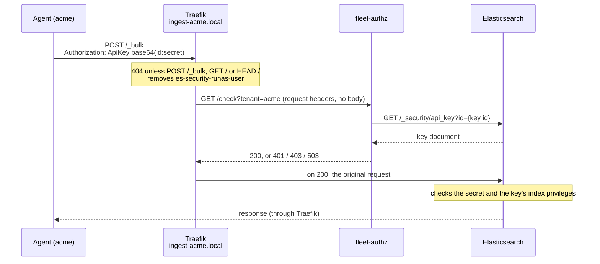

# Fleet ingest gateway

Elastic Agents of tenant `acme` send their data to `ingest-acme.local` instead of to
Elasticsearch. Traefik forwards a request only if `fleet-authz` confirms that its API key
is a Fleet output key whose index grants all belong to `acme`.

## Request flow



Traefik sets the tenant: each tenant hostname has its own middleware with a fixed
`?tenant=<name>`. The request cannot choose it.

## How a key is matched to the tenant

`fleet-authz` looks up the key id from the `Authorization` header (the part before `:`).
Elasticsearch checks the secret later. The key of an agent with Elastic Defend and
System, on 9.5.5:

```json
{
  "id": "TESTkeyid000000000001",
  "type": "rest",
  "username": "elastic/fleet-server",
  "realm": "_service_account",
  "invalidated": false,
  "expiration": null,
  "metadata": {
    "managed_by": "fleet-server", "managed": true, "type": "output",
    "agent_id": "00000000-0000-4000-8000-000000000001"
  },
  "role_descriptors": {
    "policy-16": { "indices": [{ "names": ["logs-endpoint.alerts-acme"], "privileges": ["auto_configure", "create_doc"] }, "…"] },
    "policy-18": { "indices": [{ "names": ["logs-system.auth-acme"], "privileges": ["auto_configure", "create_doc"] }, "…"] }
  }
}
```

The key is admitted for `acme` if every check passes:

| Field                                        | Must be                       | Rejects                                                       |
| -------------------------------------------- | ----------------------------- | ------------------------------------------------------------- |
| `type`                                       | `rest`                        | cross-cluster keys                                            |
| `username`                                   | `elastic/fleet-server`        | keys created by users or other services                       |
| `realm`                                      | `_service_account`            | a user named `elastic/fleet-server`                           |
| `metadata.managed_by`                        | `fleet-server`                |                                                               |
| `metadata.managed`                           | `true`                        |                                                               |
| `metadata.type`                              | `output`                      | Fleet Server's other keys, such as access keys                |
| `metadata.agent_id`                          | present                       |                                                               |
| `invalidated`                                | `false`                       | revoked keys                                                  |
| `expiration`                                 | empty or in the future        | expired keys                                                  |
| every `role_descriptors.*.indices[].names[]` | ends in `-acme`, at least one | other tenants' keys, namespace wildcards (`logs-kafka.log-*`) |

Fleet builds every index name of an output key from the agent policy's namespace
(`<type>-<dataset>-<namespace>`, plus Defend's hidden `.logs-endpoint.*` streams). A key
whose names all end in `-acme` comes from an `acme` policy, and Elasticsearch lets it
write only there. This holds as long as only `acme`'s Kibana space can create namespace
`acme` (see the [prerequisites](docs/PRODUCTION.md#prerequisites)).

`fleet-authz` answers 200 if all checks pass, 401 without exactly one `ApiKey` header (or
with a cookie), 403 for an unknown key or failed check, and 503 if Elasticsearch did not
answer or 32 lookups are running. `log-only` mode always answers 200. Admitted keys are
cached for 2 minutes, rejected ones for 10 seconds, and each new decision is logged as one
JSON line.

## Configuration

| Variable          | Default   | Meaning                                                           |
| ----------------- | --------- | ----------------------------------------------------------------- |
| `ES_URL`          | required  | Elasticsearch URL                                                 |
| `ES_API_KEY_FILE` | required  | File with the authorizer's encoded API key (`read_security` only) |
| `ES_CA_FILE`      | –         | CA bundle for Elasticsearch TLS (default: system roots)           |
| `TENANTS`         | required  | Comma-separated tenant names, none a prefix of another            |
| `MODE`            | `enforce` | `enforce` or `log-only`                                           |
| `LISTEN_ADDR`     | `:8080`   | Listen address                                                    |
| `ALLOW_TTL`       | `2m`      | Cache time for admitted keys                                      |
| `DENY_TTL`        | `10s`     | Cache time for rejected keys                                      |
| `ES_TIMEOUT`      | `5s`      | Timeout of each Elasticsearch request                             |

Each variable has a matching flag (`-es-url`, `-mode`, …). The authorizer's key:

```json
POST /_security/api_key
{ "name": "fleet-authz", "role_descriptors": { "fleet_authz": { "cluster": ["read_security"] } } }
```

Endpoints: `GET /check?tenant=<name>`, `/healthz`, `/readyz` (Elasticsearch reachable,
credential holds `read_security`) and `/metrics` (Prometheus).

## Traefik configuration

- **Docker:** [dev/traefik/dynamic/gateway.yaml](dev/traefik/dynamic/gateway.yaml)
- **Kubernetes / RKE2:** example with placeholders in
  [docs/PRODUCTION.md](docs/PRODUCTION.md#traefik-configuration-kubernetes), and
  [deploy/k8s/fleet-authz.yaml](deploy/k8s/fleet-authz.yaml) for the authorizer

To add a tenant, copy one tenant's router and `fleet-authz-<tenant>` middleware and change
the name, hostname and certificate.

## Releases

Every push to `main` runs [release.yml](.github/workflows/release.yml): it builds the
image (including `go vet` and the tests) and publishes `ghcr.io/zu3st/fleet-ingest-gateway`
as `latest` and `sha-<commit>`, with an SBOM and a provenance attestation. To check an
image:

```bash
gh attestation verify oci://ghcr.io/zu3st/fleet-ingest-gateway@sha256:<digest> --owner zu3st
```

## Development

```bash
docker run --rm -u "$(id -u):$(id -g)" -e HOME=/tmp -e GOCACHE=/tmp/gocache -v "$PWD":/src -w /src golang:1.27.3-alpine go test ./...
```

- [docs/LAB.md](docs/LAB.md): dev stack, end-to-end tests, Elastic Defend on Windows
- [docs/PRODUCTION.md](docs/PRODUCTION.md): prerequisites, rollout, known limits
- [docs/DEPENDENCIES.md](docs/DEPENDENCIES.md): dependencies and why they are trusted
